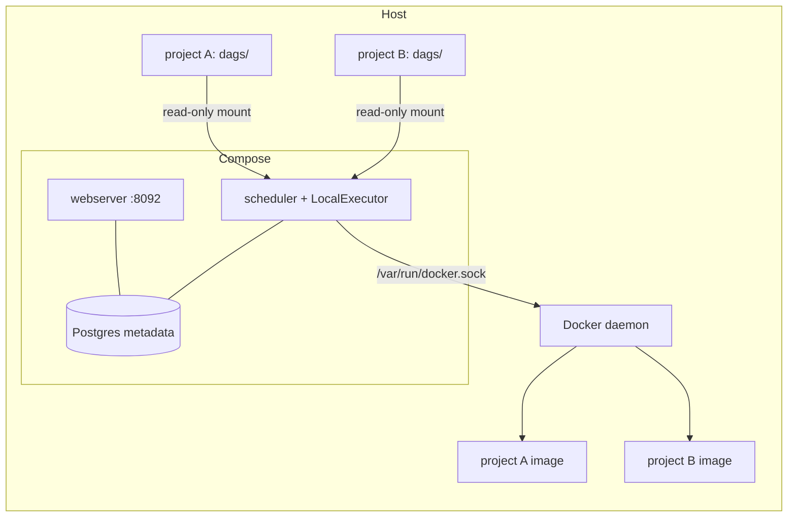

# airflow-platform

> One small Airflow instance that schedules several independent projects, each running in its own Docker image, so dependencies never clash.


## Context and problem

- **Who it is for:** a single developer or small team running several data pipelines on one machine.
- **What was painful before:** one Airflow per project, or one shared Python environment with conflicting dependencies.
- **Constraints:** single host, no cluster, no managed service.
- **Scale:** a handful of projects with daily or hourly DAGs. Not meant for high-throughput workloads.

## Architecture



The scheduler and webserver both parse DAGs mounted under `/opt/airflow/dags/<project>`. Tasks are
`DockerOperator` calls, so the work runs in the project's own image, started through the host Docker daemon.

| Layer | Tool | Why |
|---|---|---|
| Orchestration | Airflow 2.10, LocalExecutor | No broker or workers to operate on one machine |
| Metadata | Postgres 16 | Safer than SQLite with a scheduler and webserver running concurrently |
| Task runtime | `DockerOperator` | Per-project dependencies stay out of the Airflow image |

## Key design decisions

1. **DockerOperator rather than installing project dependencies in Airflow:** the platform image stays small and upgradable. Trade-off: every task pays container start-up time.
2. **LocalExecutor rather than Celery/Kubernetes:** fewer moving parts. Trade-off: parallelism is capped by one host.
3. **Read-only DAG mounts per project rather than copying DAGs in:** projects keep their own repos and release cycle. Trade-off: DAG changes are live on the host, with no versioned deploy step.
4. **UI bound to localhost by default:** reaching it from elsewhere is an explicit opt-in (see below).

## Run it

Prerequisites: Docker with the Compose plugin.

```bash
git clone https://github.com/ousskhf/airflow-platform.git
cd airflow-platform
cp .env.example .env                                        # then fill it, see comments inside
cp docker-compose.projects.example.yml docker-compose.projects.yml
docker compose -f docker-compose.yml -f docker-compose.projects.yml up -d --build
```

Open http://localhost:8092 and log in with `AIRFLOW_ADMIN_USER` / `AIRFLOW_ADMIN_PASSWORD` from `.env`.
Trigger `platform_smoke` to check that Airflow can start a container, then `hello_project` for the example project.

Values to set in `.env`:

| Variable | How to get it |
|---|---|
| `UID`, `DOCKER_GID` | `id -u` and `getent group docker \| cut -d: -f3` |
| `POSTGRES_PASSWORD`, `AIRFLOW_SECRET_KEY` | `openssl rand -hex 24` |
| `AIRFLOW_FERNET_KEY` | `python -c "from cryptography.fernet import Fernet; print(Fernet.generate_key().decode())"` |
| `AIRFLOW_ADMIN_PASSWORD` | your choice |

Compose refuses to start if a required secret is empty.

### Reaching the UI from another machine (optional)

Add `-f docker-compose.tailscale.yml` and set `TAILSCALE_IP` in `.env` to publish the UI on that private
interface as well. Do not expose it on a public interface without authentication in front.

## Add a project

1. Put DAGs in `<project>/dags/`, with IDs prefixed by the project name (`myproject_*`).
2. In `docker-compose.projects.yml`, add a read-only mount for it on both `scheduler` and `webserver`
   (see the commented line in the example file).
3. In DAGs use `DockerOperator` with the project's image. See `examples/hello/dags/hello_project.py`.
4. Bind-mount paths passed to `DockerOperator` are resolved by the **host** Docker daemon, so they must be
   host paths. Pass them in through an environment variable on `scheduler` (for example
   `MYPROJECT_HOST_PATH: ${PROJECTS_DIR}/my-project`) and read it in the DAG.

## Security notes

- The compose file mounts `/var/run/docker.sock` into Airflow. Anyone who can run a DAG can start
  arbitrary containers, which is **equivalent to root on the host**. Use it on a machine you control,
  with trusted DAG authors only.
- Secrets live in `.env`, which is gitignored. Rotate the Fernet key only with a plan for re-encrypting
  stored connections and variables.
- The UI is bound to `127.0.0.1` by default.

## Limitations and next steps

- **Known limits:** single host, no high availability, no automated backup of the Postgres volume, no CI yet.
- **Next:** a backup job for the metadata database, a Docker socket proxy to restrict API access, CI that
  validates `docker compose config` and DAG imports.

## Repository layout

```
dags/                              platform DAGs (platform_smoke)
examples/hello/dags/               example project DAG
docker-compose.yml                 Airflow, Postgres, init job
docker-compose.projects.example.yml  template for per-project DAG mounts
docker-compose.tailscale.yml       optional private-interface binding
Dockerfile                         Airflow image plus the Docker provider
```

## License

MIT, see [LICENSE](LICENSE).
